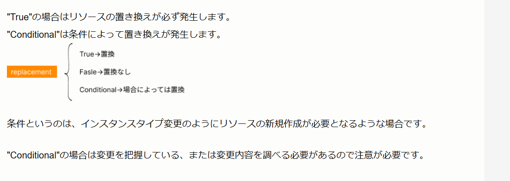

# CloudFormation変更セットのActionとReplacement

## 公式ドキュメント

### Actionの公式説明

https://docs.aws.amazon.com/ja_jp/AWSCloudFormation/latest/UserGuide/using-cfn-updating-stacks-changesets-view.html

> [Changes] (変更) セクションの各行は、CloudFormation が追加、変更、削除するリソースを表します。

> Add (追加) – スタックのテンプレートにリソースを追加すると、CloudFormation によってリソースが作成されます。

> Modify (変更) – スタックのテンプレート内のリソースのプロパティを変更すると、CloudFormation はリソースを変更します。

> Remove (削除) – スタックのテンプレートから既存のリソースを削除すると、CloudFormation によってリソースが削除されます。

また、`Modify`について次の注意事項があります。

> 変更によってリソースが中断されたり置き換え (再作成) されたりすることがあります。

つまり、`Modify`は必ずしも「既存リソースを維持したまま更新する」という意味ではありません。

### Replacementの公式説明

https://docs.aws.amazon.com/ja_jp/AWSCloudFormation/latest/UserGuide/using-cfn-updating-stacks-changesets-samples.html#using-cfn-updating-stacks-changesets-samples-replacement

> `ResourceChange` 構造の `Replacement` フィールドには、CloudFormation でリソースが再作成されるかどうかが示されています。

> `RequiresRecreation` フィールドが `Never` であれば、`Replacement` フィールドは `False` です。

複数の変更がある場合について、次のように説明されています。

> 多くの変更の中の 1 つのみで置き換えが必要な場合、CloudFormation はリソースを置き換えるため、`Replacement` フィールドは `True` に設定されます。

### CloudFormationの更新動作

https://docs.aws.amazon.com/ja_jp/AWSCloudFormation/latest/UserGuide/using-cfn-updating-stacks-update-behaviors.html

CloudFormationの更新動作は、主に次の3種類です。

- 中断を伴わない更新
- 一時的な中断を伴う更新
- 置換

置換について、公式ドキュメントでは次のように説明されています。

> CloudFormation は更新の際にリソースを再作成し、新しい物理 ID も生成されます。

> CloudFormation は、通常まず置換リソースを作成し、他の従属するリソースからの参照が置換リソースを指すように変更してから、古いリソースを削除します。

## 結論

### Actionの意味

| Action | 意味 | CloudFormationの動作 |
|---|---|---|
| `Add` | リソース追加 | 新しいリソースを作成する |
| `Modify` | リソース変更 | 設定変更またはリソースの置換を行う |
| `Remove` | リソース削除 | 既存リソースを削除する |

`Modify`だけでは、リソースが置換されるかどうかは判断できません。

`Modify`の場合は、続けて`Replacement`を確認します。

### Replacementの意味

| Replacement | 意味 | 実際の動作 |
|---|---|---|
| `False` | 置換なし | 既存リソースを維持して更新する |
| `True` | 置換あり | 新しいリソースを作成して古いリソースを削除する |
| `Conditional` | 条件付き置換 | 実際の値や参照関係によって置換の有無が決まる |

https://dev.classmethod.jp/articles/decode_json_changes_in_cloudformation/

`Conditional` の説明は上記ブログにわかりやすくまとまっている。

