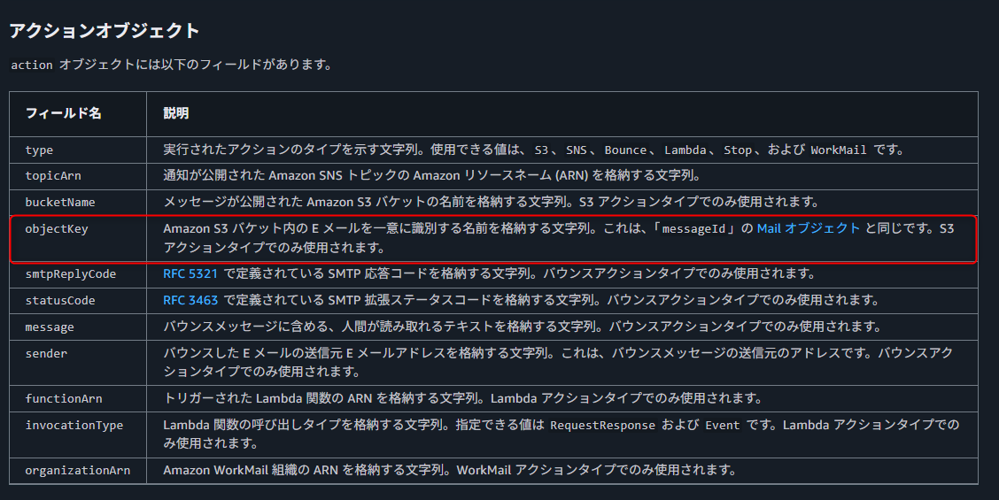
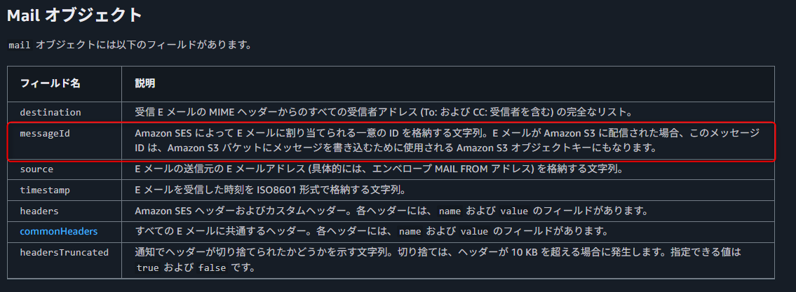

# 受信メールがS3に格納された時のオブジェクトキーはどの様な名称になりますか？

## 公式ドキュメント

https://docs.aws.amazon.com/ja_jp/ses/latest/dg/receiving-email-notifications-contents.html

## オブジェクトキーとは

https://docs.aws.amazon.com/ja_jp/AmazonS3/latest/userguide/object-keys.html

>オブジェクトキー (またはキー名) によって、Amazon S3 バケット内のオブジェクトは一意に識別されます。オブジェクトの作成時にキー名を指定できます。例えば、Amazon S3 コンソールでは、バケットを選択すると、そのバケットに含まれるオブジェクトのリストが表示されます。表示される名前がオブジェクトキーです。
>

## まとめ
SESによってEメールに割り当てられる一意のIDがオブジェクトキー名となる。
その為S3に格納されたオブジェクトキーを見るだけでは、どの受信メールかの判別は難しく
内部のメールデータを参照する必要がある。
